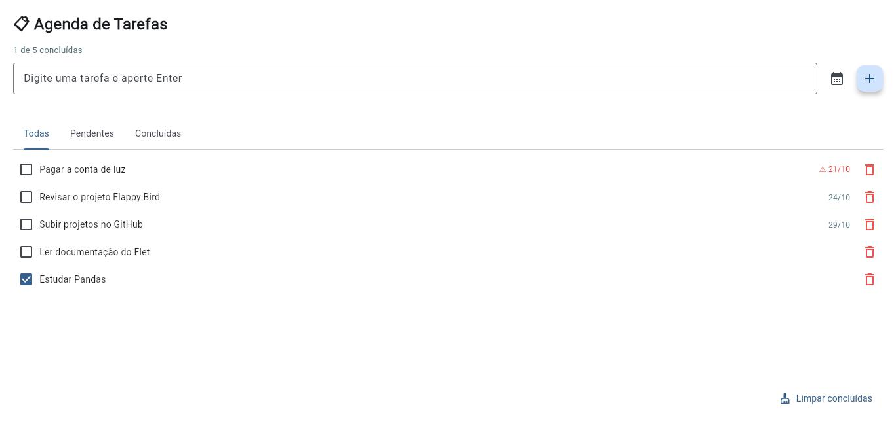

# 📋 Agenda de Tarefas

Aplicativo desktop de lista de tarefas feito em **Python** com [Flet](https://flet.dev/) e **SQLite**.
As tarefas ficam salvas em um banco local, então continuam lá quando você abre o app de novo.



## Funcionalidades

- Adicionar tarefas (Enter ou botão **+**)
- **Prazo** opcional escolhido em um calendário
- Aviso **⚠ em vermelho** para tarefas atrasadas
- Lista ordenada: pendentes primeiro, com o prazo mais próximo no topo
- Filtros **Todas / Pendentes / Concluídas**
- Marcar como concluída, **excluir** tarefa e **limpar concluídas**
- Contador de progresso ("2 de 5 concluídas")

## Como rodar

Requer **Python 3.10+**.

```bash
git clone https://github.com/MjesusGyn/agenda-tarefas.git
cd agenda-tarefas

python -m venv .venv
# Windows
.venv\Scripts\activate
# Linux / macOS
source .venv/bin/activate

pip install -r requirements.txt
python app.py
```

Na primeira execução o Flet baixa o seu cliente desktop, o que pode levar alguns segundos.

## Testes

A camada de banco de dados tem testes automatizados com **pytest**:

```bash
pip install -r requirements-dev.txt
pytest
```

## Estrutura

```
agenda-tarefas/
├── app.py            # interface (Flet)
├── banco.py          # acesso ao SQLite (classe BancoTarefas)
├── tests/
│   └── test_banco.py # testes do banco
├── assets/icon.png   # ícone do app
└── requirements.txt
```

A interface e o banco ficam separados: `banco.py` não sabe nada de Flet, então pode ser testado sozinho
e reaproveitado em outra interface (web, linha de comando etc.).

## Gerar executável (opcional)

```bash
pip install pyinstaller
pyinstaller --onefile --windowed --icon assets/icon.png --name "Agenda de Tarefas" app.py
```

## Créditos

Inspirado no projeto *ToDo App* de [dalton95](https://github.com/dalton95).
Esta versão foi reescrita para o Flet 1.0 e ganhou: prazos com calendário, aviso de atraso, exclusão de tarefas,
limpeza das concluídas, contador de progresso, IDs no banco (tarefas com o mesmo nome não se confundem mais)
e testes automatizados.
